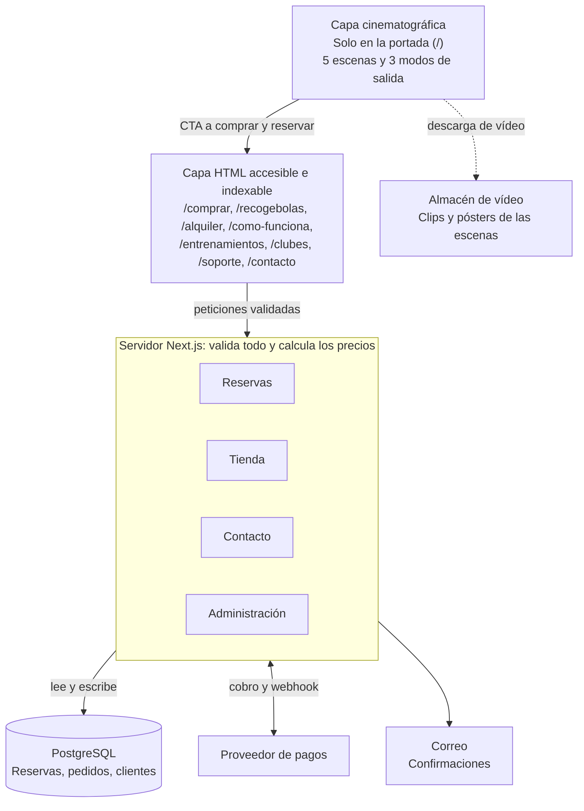
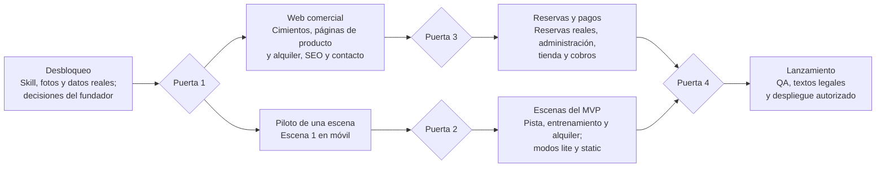

# Hammer Padel — Documento de diseño de la web

Borrador para aprobación · 2026-11-13 · Mauro Díaz Terol

## Resumen ejecutivo

Propongo una web en Next.js con un Scroll World de **5 escenas solo en la portada**, un cierre en HTML normal que desemboca en la reserva, y compra y reservas totalmente independientes de la animación.

**Bloqueo a resolver:** la skill `scroll-world` no está disponible en esta sesión (detalle en la sección siguiente). No he podido leerla, así que todo lo que depende de ella (formato de los recursos, reproductor, número exacto de generaciones, costes) queda marcado como hipótesis.

Convención del documento: **\[Confirmado\]** viene del brief o está verificado; **\[Hipótesis\]** es un supuesto por validar; **\[Recomendación\]** es mi propuesta para que decidas.

Decisiones principales que propongo:

- **5 escenas de vídeo + cierre HTML**, en lugar de las 7 del brief: «Descubrimiento» se funde con «La pista» y la «Transición comercial» es interfaz normal, no vídeo.
- **Dos capas**: la cinematográfica solo en `/`; todo lo transaccional, informativo e indexable en HTML accesible.
- **Reservas**: la protección contra dobles reservas vive en PostgreSQL (restricción de exclusión), no en la interfaz.
- **Pagos**: no se instala ni configura nada; la sección 9 compara alternativas y te pide elegir.
- **Generación**: antes de aprobar presupuesto, un piloto de unas 10 generaciones. Estimación total: 60 a 180 generaciones, \~100 esperadas.
- **MVP**: tres escenas generadas (pista, entrenamiento, alquiler) y los productos con fotografía real en HTML.

Lo que te pido: leer el documento y resolver la lista final de decisiones pendientes. Hasta entonces no se implementa ni se gasta nada.

## Verificación de la skill scroll-world

**La skill `scroll-world` no se ha podido localizar, por lo que no sé cómo funciona realmente.** No la he usado ni asumido nada de ella.

| Dónde se buscó | Resultado |
| --- | --- |
| Skills habilitadas en tu cuenta | Solo aparece `computer-use` entre las que coinciden con la búsqueda |
| Catálogo de skills disponibles para añadir | Sin resultados para «scroll-world» |
| Caché local de skills de esta sesión | Contiene skills generales (docs, pdf, pptx, vídeo, posters…), ninguna llamada scroll-world |
| Repositorio `Xavidoctor/hammerpadel` | Vacío: sin commits ni carpeta `.claude` |
| Carpeta de tu equipo | No hay ninguna carpeta conectada a esta sesión |

**Qué desconozco por esto** \[Hipótesis en todo lo que sigue\]: qué entradas pide (guión, imágenes, vídeos), qué herramienta de generación usa, si produce vídeo o secuencias de fotogramas, si admite 9:16 nativo, qué reproductor incluye y cuánto cuesta cada ejecución.

**Hipótesis de trabajo:** una experiencia de scroll cinematográfico «fija» una escena en pantalla y avanza un vídeo o una secuencia de fotogramas según el scroll. Diseño todo para ser compatible con esa técnica genérica, sin depender de detalles de la skill.

**Para desbloquearlo necesito una de estas tres cosas:**

- que la skill esté en tu equipo (por ejemplo en `~/.claude/skills/scroll-world`) y conectes esa carpeta a la sesión desde la app de escritorio;
- que me pases su `SKILL.md` (y archivos asociados) pegado o adjunto;
- que la añadas a tu cuenta de claude.ai.

Cuando la lea, revisaré este documento y corregiré las secciones marcadas como hipótesis.

## 1. Arquitectura propuesta

**Dos capas: una cinematográfica limitada a la portada y otra de HTML normal para todo lo que informa, vende o reserva.** \[Recomendación\]



*Arquitectura propuesta: 2 capas, servidor y servicios. Los servicios de la fila inferior son candidatos; ninguno está decidido ni contratado.*

El contenido se genera en el servidor, así que es indexable aunque el vídeo no cargue. Los botones de la portada llevan a páginas que funcionan sin animación.

**Mapa de páginas:**

| Ruta | Función | Scroll World | Transaccional |
| --- | --- | --- | --- |
| `/` | Portada y conversión; incluye el selector de reserva tras las escenas | Sí | Reserva |
| `/comprar` | Ficha y compra de Hammer Padel | No | Compra |
| `/recogebolas` | Ficha y compra del Recogebolas Hammer | No | Compra |
| `/alquiler` | Reservas y condiciones | No | Reserva |
| `/como-funciona` | Funcionamiento y demostraciones | No | No |
| `/entrenamientos` | Ejercicios, vídeos y consejos | No | No |
| `/clubes` | Información y solicitud comercial para clubes y academias | No | Formulario |
| `/soporte` | Manuales y preguntas frecuentes | No | No |
| `/contacto` | Contacto general y comercial | No | Formulario |

Se añaden páginas legales, confirmaciones de reserva y pedido, carrito y checkout cuando se aprueben, y un panel `/admin` protegido que no forma parte del árbol público.

**Pila candidata** \[no decidida\]: Next.js con TypeScript estricto y Tailwind, PostgreSQL (por ejemplo mediante Supabase) y alojamiento en Vercel u otro equivalente. Un único servidor de aplicación; sin microservicios, porque con dos productos y unas pocas máquinas no hacen falta.

## 2. Storyboard definitivo

**Cinco escenas cinematográficas encadenadas por una misma pista azul, una luz fría y la pelota amarilla como hilo conductor, más un cierre en HTML.** Todo el texto y los botones son HTML real superpuesto al vídeo, nunca incrustado en él. \[Recomendación\]

### Escena 1 — La pista (incluye el descubrimiento de la máquina)

- **Plano:** pista azul vacía en penumbra, focos cenitales. La cámara avanza a ras de suelo y la silueta de la máquina emerge al fondo en contraluz hasta un plano medio.
- **Texto:** HAMMER PADEL, y después la frase de marca (provisional).
- **CTA (visibles desde el primer pantallazo):** Comprar máquina — 2.300 € · Alquilar — 20 € / 90 min.
- **Pendiente:** fotos reales de la máquina, color real y logo.

### Escena 2 — Entrenamiento

- **Plano:** cámara lateral algo elevada. La máquina lanza pelotas amarillo fluorescente y un jugador anónimo (sin rostro reconocible) responde. Ritmo repetitivo.
- **Texto:** titular NO ESPERES A TU COMPAÑERO. ENTRENA. Las etiquetas Derecha · Revés · Bandeja · Víbora · Volea · Desplazamiento · Repetición aparecen una a una sincronizadas con el scroll.
- **Pendiente:** confirmar con el fabricante qué golpes y trayectorias admite la máquina. Las etiquetas describen golpes del jugador, no programas de la máquina, hasta que se confirme.

### Escena 3 — Producto

- **Plano:** órbita lenta alrededor de la máquina sobre fondo grafito con luz de contorno azul. Sin especificaciones.
- **Texto:** HAMMER PADEL · 2.300 €.
- **CTA:** COMPRAR HAMMER PADEL (a `/comprar`).
- **Recomendación:** resolverla con fotografía real o giro de producto real, no con vídeo generado. Es la escena donde un error en el diseño de la máquina más daña la confianza.
- **Pendiente:** si 2.300 € incluye IVA, envío y disponibilidad.

### Escena 4 — Recogebolas

- **Plano:** la cámara desciende desde la máquina hasta el suelo, cubierto de pelotas (macro, poca profundidad de campo). Entra el recogebolas y recoge.
- **Texto:** MENOS TIEMPO RECOGIENDO. MÁS TIEMPO ENTRENANDO. · RECOGEBOLAS HAMMER · 85 €.
- **CTA:** COMPRAR RECOGEBOLAS (a `/recogebolas`).
- **Pendiente:** foto real y funcionamiento exacto del recogebolas. No se dibuja ningún mecanismo hasta verlo.

### Escena 5 — Alquiler

- **Plano:** la cámara sale de la pista, asciende y sobrevuela un mapa estilizado de la Marina Alta. Se iluminan cuatro puntos: Dénia, Ondara, La Xara, Pedreguer.
- **Texto:** ¿QUIERES PROBAR HAMMER PADEL? · ALQUÍLALA POR 20 € · 90 MINUTOS.
- **CTA:** RESERVAR ENTRENAMIENTO (baja al cierre HTML).
- **Regla:** mapa abstracto, sin nombres de pistas ni instalaciones, porque las pistas concretas no están decididas.

### Cierre — interfaz convencional (no es vídeo)

La animación se libera y aparece el selector de reserva real en 4 pasos (ubicación, fecha, horario, reservar/pagar) con el precio visible, seguido de accesos a comprar, entrenamientos y contacto para clubes. Es el mismo componente que `/alquiler`.

### Evaluación del copy

| Texto del brief | Valoración | Propuesta |
| --- | --- | --- |
| Tu entrenamiento. Tu ritmo. Tu pista. | Memorable. «Tu ritmo» sugiere cadencia ajustable, dato no confirmado. | Mantener como provisional; si la máquina no regula cadencia, usar «Tu entrenamiento. Tu pista. Sin esperas.» |
| No esperes a tu compañero. Entrena. | El mejor mensaje: directo y cierto por definición del producto. | Mantener. |
| 100 bolas. Un objetivo. Repetir hasta dominarlo. | «100 bolas» es una cifra de capacidad no confirmada. | No usar hasta verificar. Alternativa sin cifra: «Mucha repetición. Un objetivo. Domínalo.» |
| Menos tiempo recogiendo. Más tiempo entrenando. | Claro y comparativo; no cuantificar. | Mantener sin porcentajes ni minutos. |
| Tu pista. Tu ritmo. Hammer Padel. | Variante de la primera, redundante en la misma página. | Reservarla para el cierre o anuncios. |
| ¿Quieres probarla? Alquílala por 20 € | Buena conversión. Aclarar si el precio incluye IVA. | Mantener y añadir «IVA incluido» solo si se confirma. |

## 3. Número recomendado de escenas

**Cinco escenas de vídeo más un cierre en HTML**, en lugar de las siete del brief. \[Recomendación\] Cada escena generada multiplica el coste (se hace en escritorio y en móvil) y la atención móvil se agota pronto.

| Escena del brief | Decisión | Motivo |
| --- | --- | --- |
| 1. La pista | Mantener (E1) | Apertura y promesa de marca |
| 2. Descubrimiento | Fundir en E1 | El primer mensaje ya incluye la aparición de la máquina; separarla duplica el coste |
| 3. Entrenamiento | Mantener (E2) | Demuestra la utilidad del producto |
| 4. Presentación del producto | Mantener (E3) | Escena de compra principal; mejor con fotografía real |
| 5. Recogebolas | Mantener (E4) | Segundo producto |
| 6. Alquiler | Mantener (E5) | Segunda vía de conversión |
| 7. Transición comercial | HTML, no vídeo | La reserva no debe depender de animaciones |

**Duración del recorrido** \[Hipótesis a ajustar en pruebas\]: unas 5 pantallas de scroll por escena, 25 en total en escritorio y algo menos en móvil. Cada clip dura entre 5 y 8 segundos.

El máximo que no conviene superar: 6 escenas. A partir de ahí el usuario tarda demasiado en llegar a la reserva.

## 4. Transición entre escenas

**Cada transición se apoya en la pelota amarilla o en un movimiento continuo de cámara, y la última sale del vídeo hacia la interfaz normal sin salto de scroll.** \[Recomendación\]

| Paso | Recurso narrativo | Qué ocurre |
| --- | --- | --- |
| E1 → E2 | Continuidad de espacio | La cámara rodea la máquina hasta el primer lanzamiento; la pista es la misma |
| E2 → E3 | La última pelota cruza cámara | El plano se oscurece a fondo grafito de estudio y aparece el producto |
| E3 → E4 | Las pelotas caen | La cámara las sigue hasta el suelo, ya cubierto de pelotas |
| E4 → E5 | Retroceso de cámara | Sale de la pista y asciende hacia el mapa de la Marina Alta |
| E5 → cierre | Fundido a grafito | La escena deja de estar fijada y el scroll vuelve a ser normal |

**Dos formas de construirlas** \[Hipótesis, depende de la skill y del generador\]:

- **Clips independientes** con fundido o máscara en el punto de cruce: más barato y robusto, con riesgo de cortes visibles.
- **Clips encadenados**: el último fotograma de una escena es el primero de la siguiente. Mejor continuidad, pero un fallo obliga a repetir lo que viene después.

Recomiendo empezar con clips encadenados en el piloto y medir.

**Reglas de interacción** \[Recomendación, alineada con los requisitos del proyecto\]:

- Scroll nativo; sin secuestrar la rueda ni cambiar la velocidad del desplazamiento.
- Enlace visible «Saltar la experiencia» al principio, operable con teclado.
- Los botones de compra y alquiler siguen visibles y funcionales durante toda la experiencia.
- Al terminar, el enlace `#reservar` y el botón de la E5 llevan al selector sin depender de que el vídeo haya cargado.

## 5. Dirección artística

**Precisión de ingeniería deportiva en negro y grafito, con el amarillo fluorescente reservado a lo que se compra o se mueve.** La máquina real es siempre la protagonista.

**Paleta** \[Hipótesis: valores de partida a validar con el logo y la marca reales\]:

| Uso | Valor de partida | Regla |
| --- | --- | --- |
| Base | Negro `#0A0A0B` | Fondo por defecto |
| Superficies | Grafito `#1B1D21` | Paneles y fondos de producto |
| Pista | Azul `#1F5FBF` | Ambiente e iluminación; no para texto pequeño sobre negro |
| Acento | Amarillo `#D7FF1E` | Pelotas, precios y botones principales; poca superficie |
| Texto | Blanco `#FFFFFF` | Contraste alto sobre negro y grafito |

**Tipografía** \[Recomendación\]: titulares en mayúsculas con una sans condensada y muy pesada, en tamaños grandes; texto en una sans neutra muy legible. Candidatas con licencia abierta a probar: Barlow Condensed o similar para titulares e Inter para texto. Se autoalojan y se recortan a los caracteres necesarios.

**Luz y cámara:**

- Luz principal baja y dura, contorno azul, sombras profundas.
- Poca profundidad de campo y movimientos lentos y continuos; ningún corte rápido.
- Una idea por pantalla y titulares de seis palabras o menos.

**Reglas de composición:**

- Mucho espacio vacío; el producto ocupa al menos un tercio del encuadre cuando es protagonista.
- Botones principales en amarillo con texto negro; secundarios con contorno blanco.
- Nada de tarjetas apiladas, degradados decorativos ni iconos genéricos.

**Fidelidad al producto** \[Confirmado como regla del proyecto\]: no se inventan componentes físicos. Cada fotograma generado que muestre la máquina o el recogebolas se compara con las fotos reales antes de aprobarse. Cualquier discrepancia (forma, piezas, color, logo) lo descarta.

**Jugadores:** figuras anónimas, sin rostros identificables ni marcas de terceros visibles.

## 6. Arquitectura frontend

**Next.js (App Router) con TypeScript estricto y Tailwind, renderizando en servidor todo el contenido y cargando el reproductor de Scroll World como una isla de cliente diferida.** \[Recomendación; son tecnologías candidatas, no decisiones cerradas\]

**Estructura de carpetas propuesta:**

```text
app/
  (marketing)/page.tsx        # portada + Scroll World
  comprar/  recogebolas/  alquiler/  como-funciona/
  entrenamientos/  clubes/  soporte/  contacto/
  legal/                      # borradores para revisión
  admin/                      # protegido, fuera del árbol público
  api/                        # webhooks y endpoints de servidor
components/
  ui/  scroll-world/  booking/  shop/
lib/
  db/  booking/  pricing/  payments/  seo/  i18n/
content/                      # MDX de entrenamientos y soporte
public/scroll-world/{desktop,mobile}/
docs/                         # decisiones de arquitectura
```

**Principios:**

- **Contenido primero**: titulares, textos, precios y botones de cada escena son HTML real en el servidor. El vídeo solo los acompaña.
- **Manifiesto de escenas**: un archivo de configuración describe cada escena (rangos de scroll, recursos por formato, textos, CTA). Cambiar una escena no exige tocar código.
- **Reproductor aislado**: el componente `scroll-world` se importa de forma dinámica tras la carga inicial. Si falla, la página sigue siendo una portada completa en HTML.
- **Tres modos de salida**: `full`, `lite` y `static` (sección 7).
- **Validación con Zod** en cada formulario y endpoint; los precios y la disponibilidad nunca se aceptan del navegador.
- **i18n desde el inicio**: textos en archivos de mensajes, español por defecto, rutas preparadas para más idiomas.
- **Pruebas**: Vitest para lógica de precios y reservas; Playwright para flujos de reserva y compra en móvil y escritorio.

**Decisión técnica pendiente de la skill** \[Hipótesis\]: reproducir un vídeo controlado por `currentTime` suele dar tirones salvo que se codifique con fotogramas clave en todos los fotogramas; una secuencia de imágenes sobre `canvas` se mueve mejor pero pesa más. Se elige tras ver qué produce la skill y probar en un iPhone y un Android de gama media reales.

## 7. Estrategia desktop / móvil

**El móvil se diseña y se genera en vertical 9:16 desde el principio; no se recorta el material de escritorio.** \[Confirmado como requisito del proyecto\] Eso significa doble producción de recursos, ya incluida en la estimación de la sección 15.

| Aspecto | Escritorio | Móvil |
| --- | --- | --- |
| Formato nativo | 16:9 (partida 1920×1080) | 9:16 (partida 1080×1920) |
| Entrega \[Hipótesis\] | 1280×720 | 720×1280 |
| Composición | Producto al centro-derecha, texto a la izquierda | Producto en los dos tercios superiores, texto y CTA en la zona del pulgar |
| Prompt y generación | Propios | Propios, no derivados del de escritorio |
| Selección | Por proporción de ventana, no por tipo de dispositivo | Igual: móvil apaisado usa el juego horizontal |

Las tabletas en vertical usan el juego 9:16 con una zona segura central, para que ningún elemento clave quede recortado.

**Tres modos y qué los activa** \[Recomendación; los umbrales son hipótesis a calibrar con pruebas\]:

| Señal detectada | Modo |
| --- | --- |
| `prefers-reduced-motion`, o JavaScript desactivado | `static` |
| Ahorro de datos o conexión 2G/3G | `static` |
| Modo de bajo consumo en iOS (no se detecta directamente: el vídeo no arranca solo) | `lite` |
| Pocos núcleos o poca memoria, cuando el navegador lo informa | `lite` |
| El vídeo no tiene buffer suficiente tras unos segundos | baja un nivel |
| Resto de casos | `full` |

- **`full`**: escenas controladas por scroll.
- **`lite`**: póster por escena con un bucle corto sin control por scroll.
- **`static`**: imágenes con aparición suave por CSS; sin vídeo.

En los tres, el mismo HTML, los mismos botones y los mismos precios. Un interruptor visible «Reducir animación» permite cambiar de modo manualmente.

**Prioridad móvil:** el primer pantallazo debe mostrar HAMMER PADEL, la frase de marca y los dos botones de compra y alquiler sin esperar a ningún vídeo. El póster de la E1 es la imagen principal de carga.

**Pruebas obligatorias antes de dar el móvil por bueno:** iPhone con Safari (incluido bajo consumo), Android gama media con Chrome y conexión lenta simulada.

## 8. Sistema de reservas

**Una máquina nunca puede tener dos reservas solapadas porque la base de datos lo impide, no porque la interfaz lo oculte.** Es un módulo independiente de Scroll World y de la tienda. \[Recomendación; el modelo se ajusta cuando se confirmen las condiciones reales del alquiler\]

**Entidades:**

| Entidad | Para qué sirve | Notas |
| --- | --- | --- |
| `locations` | Localidades y pistas | Zona horaria propia; Dénia, Ondara, La Xara, Pedreguer |
| `machines` | Unidades físicas | Pertenecen a una ubicación; estado activa / en mantenimiento |
| `rental_offers` | Duración y precio | 90 min y 20 € hoy; editable en administración; admite precios por ubicación o máquina |
| `availability_rules` | Horario semanal | Franjas por ubicación o máquina, en hora local |
| `time_blocks` | Mantenimiento y bloqueos | Cierran la máquina sin tocar reservas |
| `bookings` | Reservas | Guardan una copia del precio y la duración contratados |
| `booking_events` | Historial | Cada cambio de estado, con fecha y autor |
| `customers` | Clientes | Solo los datos mínimos |
| `payments` | Pagos | Compartida con la tienda; un pago apunta a una reserva o a un pedido |

**Estados de una reserva:** `hold` (bloqueo temporal con caducidad) → `pending_payment` → `confirmed` → `completed`; salidas: `cancelled`, `expired`, `no_show`, `rescheduled` (enlaza con la reserva nueva).

**Protección contra dobles reservas** \[Recomendación\]: una restricción de exclusión de PostgreSQL sobre el intervalo de tiempo de cada máquina. Concepto:

```sql
CREATE EXTENSION IF NOT EXISTS btree_gist;

ALTER TABLE bookings ADD CONSTRAINT no_overlap
  EXCLUDE USING gist (
    machine_id WITH =,
    tstzrange(starts_at, ends_at_with_buffer, '[)') WITH &&
  ) WHERE (status IN ('hold','pending_payment','confirmed'));
```

Si dos clientes pulsan a la vez sobre la misma franja, la segunda inserción falla y la aplicación muestra «franja ya no disponible». El mismo intervalo incluye un margen opcional entre sesiones (`buffer`) para entrega y recogida.

**Cómo se evitan las reservas incompletas eternas:** los `hold` caducan a los pocos minutos (duración por decidir). Como la restricción no puede depender de la hora actual, un proceso programado marca los caducados y, además, cada intento de reserva libera los caducados de esa máquina dentro de la misma transacción.

**Fechas y zonas horarias:** todo se guarda en UTC (`timestamptz`). Las franjas se generan en la hora local de la ubicación (`Europe/Madrid`), lo que cubre los cambios de horario de marzo y octubre. La disponibilidad se calcula (reglas menos reservas menos bloqueos); no se guardan franjas futuras precalculadas.

**Flujo en el servidor:**

1. `GET` de disponibilidad: franjas libres reales, con caché de pocos segundos.
2. `POST` de bloqueo: crea el `hold`; el servidor calcula el precio, nunca lo recibe del navegador.
3. Pago o confirmación: la reserva pasa a `confirmed` solo cuando el proveedor de pago lo confirma por webhook firmado y con clave de idempotencia.

**Seguridad:** la base de datos no acepta escrituras directas del público; todo pasa por funciones del servidor. El panel de administración exige autenticación y roles comprobados en el servidor.

**Pruebas obligatorias:** lanzar muchas reservas simultáneas de la misma franja y comprobar que exactamente una tiene éxito; repetir un webhook y comprobar que no duplica; reservar a ambos lados de un cambio de hora.

**Experiencia de reserva:** cuatro pasos (ubicación, fecha, horario, reservar y pagar), calendario operable con teclado y pensado primero para móvil. El precio se ve desde el primer paso. No se muestran franjas que no existan.

**Decisiones pendientes que cambian el modelo:** confirmación inmediata o solicitud que tú apruebas; duración del bloqueo temporal; margen entre sesiones; fianza; política de cancelación y devolución; horarios y antelación mínima; quién aporta la pista; entrega y recogida de la máquina; responsabilidad por daños.

## 9. Ecommerce

**Con dos productos físicos no compensa construir una tienda completa: propongo un catálogo mínimo propio y un checkout alojado por un proveedor de pagos, decidido por ti entre las alternativas siguientes.** No se instala ni se configura ningún proveedor hasta tu aprobación. Las comisiones y condiciones no se comparan aquí porque cambian: hay que verificar las vigentes antes de decidir.

| Opción | Qué es | Ventajas | Inconvenientes | Encaje |
| --- | --- | --- | --- | --- |
| A. Stripe Checkout alojado + catálogo propio | Página de pago del proveedor; pedidos y catálogo en nuestra base de datos | Control total del diseño y de los datos; el mismo proveedor sirve a tienda y reservas; pocas piezas | Pedidos, stock y envíos hay que construirlos (en mínimo) | Alto para 2 productos y reservas |
| B. Shopify (tienda aparte o sin interfaz propia) | Ecommerce completo ya hecho | Stock, impuestos, envíos, devoluciones, cupones y packs listos | Cuota mensual; la integración con nuestra web y con las reservas es más pesada; el alquiler seguiría siendo propio | Alto si priorizas logística y crecimiento del catálogo |
| C. Redsys (TPV virtual de tu banco) | Pasarela bancaria muy extendida en España | Cercana a tu banco; suele incluir Bizum | Integración más antigua; depende de lo que ofrezca tu entidad | Medio; posible segundo método |
| D. Motor de ecommerce de código abierto (por ejemplo Medusa) | Backend de tienda propio | Flexibilidad total | Hay que alojarlo y mantenerlo; contradice el objetivo de bajo coste operativo | Bajo hoy |

Otras piezas a evaluar: PayPal, Mollie y financiación de terceros (por ejemplo SeQura) \[a verificar disponibilidad y condiciones\].

**Recomendación preliminar:** la opción A, o la B si prefieres delegar stock, envíos e impuestos. La decisión depende de cuánto quieras gestionar tú y de cómo vayas a enviar una máquina de 2.300 € (peso y transporte desconocidos).

**Particularidades de una venta de 2.300 €:**

- Muchos compradores (clubes, academias) pedirán factura con NIF y quizá pago por transferencia.
- Hay que confirmar IVA aplicable, transporte, disponibilidad y condiciones de venta antes del checkout.
- Desistimiento, garantías y devoluciones requieren textos revisados por un profesional; el documento solo prepara borradores.

**Modelo preparado para crecer:**

- Tablas: `products`, `product_variants`, `prices` (versionados), `orders`, `order_items`, `customers`, `payments`.
- El servidor calcula todos los importes; el navegador solo envía identificadores de producto y cantidades.
- El proveedor de pagos queda detrás de una interfaz propia (`PaymentProvider`), de modo que cambiarlo o añadir otro no afecta al resto.
- Packs, cupones, accesorios, repuestos y financiación se añaden como datos o extensiones, sin reescribir el catálogo. No se implementan sin tu aprobación.
- Los pedidos pasan a pagados solo por webhook firmado e idempotente, igual que las reservas.

## 10. SEO

**Cada búsqueda importante tiene una página con contenido real que responde a ella, y la portada cinematográfica no sustituye ningún texto indexable.** Sin repetir palabras clave de forma artificial.

| Búsqueda | Página que la atiende |
| --- | --- |
| máquina lanzapelotas pádel / Hammer Padel | `/` y `/comprar` |
| máquina entrenamiento pádel | `/como-funciona` |
| entrenamiento individual pádel | `/entrenamientos` |
| lanzapelotas para entrenadores y clubes | `/clubes` |
| alquiler máquina pádel Dénia, Ondara, La Xara, Pedreguer | `/alquiler`, con una sección por localidad |

**No se crean cuatro páginas locales duplicadas.** \[Confirmado como requisito\] Una página propia por localidad solo se justifica cuando haya contenido distinto y real: pista concreta, horarios, cómo llegar. Hoy no existe.

**Portada:**

- Un único `h1` visible y real con la propuesta de valor.
- Todos los textos de las escenas están en el HTML inicial y son visibles cuando aparecen; no se oculta texto para buscadores.
- Tras la experiencia, una sección corta de texto «Qué es Hammer Padel» con enlaces a producto, alquiler y entrenamientos.
- Los vídeos llevan póster y descripción; las imágenes llevan texto alternativo.

**Técnico:**

- Metadatos, título y descripción únicos por página; etiqueta `canonical`; `sitemap.xml` y `robots.txt`.
- Datos estructurados: `Organization`, `Product` con `Offer` (solo cuando precio, IVA y disponibilidad estén confirmados), `Service` con `areaServed` para el alquiler y `BreadcrumbList`. Sin valoraciones ni reseñas inventadas.
- URLs limpias en español; `hreflang` cuando existan otros idiomas.
- Perfil de empresa en Google: solo si hay una dirección o un área de servicio real; no se asume local propio.

**Seguimiento:** Search Console desde el inicio. La analítica que use cookies no se activa sin gestión de consentimiento; alternativa a valorar: analítica sin cookies \[pendiente de decidir\].

## 11. Performance

**La portada debe pintarse y ser usable sin descargar ningún vídeo; el Scroll World se carga después, escena a escena.** Objetivos de Core Web Vitals en móvil, medidos en el percentil 75: LCP hasta 2,5 s, INP hasta 200 ms, CLS hasta 0,1 (umbrales «bueno» de Google).

**Carga progresiva** \[Recomendación\]:

1. **Etapa 0**: HTML, CSS y póster de la E1 en AVIF o WebP. Sin vídeo.
2. **Etapa 1**: con la página ya interactiva, se descarga la E1.
3. **Etapa 2**: al llegar a mitad de una escena se precarga la siguiente.
4. **Etapa 3**: el resto, solo si la conexión y el modo lo permiten.

**Presupuestos de partida** \[Hipótesis a calibrar con el piloto\]:

| Modo | Peso total orientativo | Notas |
| --- | --- | --- |
| `static` | hasta 0,4 MB | Solo imágenes optimizadas |
| `lite` | hasta 2,5 MB | Pósters y bucles cortos |
| `full` | hasta 8 MB, repartidos en etapas | Nunca todo de golpe |

**Otras medidas:**

- **Formatos**: MP4 H.264 como base universal y, si compensa, WebM como alternativa; imágenes en AVIF o WebP con dimensiones fijas.
- **Reserva de espacio** para vídeo e imágenes con `aspect-ratio`, para que nada se desplace.
- **Fuentes**: autoalojadas, recortadas, con `font-display: swap`; solo la de titulares se precarga.
- **JavaScript**: sin librerías de animación pesadas si no hacen falta; escucha de scroll pasiva con `requestAnimationFrame`.
- **Terceros** (analítica, mapas, chat): diferidos y tras consentimiento cuando proceda.
- **Almacenamiento de vídeo**: el ancho de banda de vídeo puede encarecer el alojamiento web; evaluar un servicio de entrega de archivos aparte \[coste por verificar\].

**Medición:** Lighthouse en integración continua, WebPageTest con perfil de Android de gama media y conexión lenta, y datos reales de usuarios con la librería `web-vitals`. Una página que no cumpla los umbrales en móvil no se da por terminada.

## 12. Accesibilidad

**El objetivo es WCAG 2.2 nivel AA en toda la web, y que comprar o reservar funcione con teclado, lector de pantalla y sin animación.** \[Recomendación\] Como el comercio electrónico puede quedar dentro de la normativa europea de accesibilidad (con exenciones para microempresas), conviene que una asesoría confirme si te aplica \[pendiente de verificar\].

**Scroll World:**

- Respeta `prefers-reduced-motion` y ofrece un interruptor manual «Reducir animación».
- Enlace inicial «Saltar la experiencia», visible al recibir foco.
- Sin secuestro de scroll ni cambios de velocidad.
- Los vídeos son decorativos: sin audio, ocultos a lectores de pantalla y con el contenido equivalente en texto.
- Las escenas fuera de pantalla no reciben foco (`inert`).
- Sin destellos de más de tres por segundo, atención especial a las pelotas amarillas.

**Interfaz:**

- Contraste mínimo de 4,5:1 en texto normal; el azul de pista no se usa para texto pequeño sobre negro.
- Foco visible, orden de tabulación lógico, jerarquía de títulos correcta, idioma declarado.
- Botones y zonas táctiles de al menos 44 px; el estándar exige 24 px como mínimo.
- Formularios con etiquetas visibles, errores asociados al campo y anunciados.
- Calendario de reservas operable con teclado y lector de pantalla; para evitar errores se parte de una librería accesible ya probada (por ejemplo React Aria) en vez de construirlo desde cero.

**Verificación:** pruebas automáticas (axe) en integración continua, recorrido manual solo con teclado y una prueba con VoiceOver en iPhone y con un lector en escritorio antes de publicar.

## 13. Dependencias externas necesarias

**Tres cosas bloquean el trabajo creativo: la skill `scroll-world`, las fotografías reales de los productos y las especificaciones confirmadas.** El resto se puede preparar mientras tanto.

| Dependencia | Para qué | Estado |
| --- | --- | --- |
| Skill `scroll-world` | Producir y reproducir el Scroll World | **No localizada** |
| Fotos reales de la máquina y del recogebolas (varios ángulos, fondo neutro) y un vídeo de uso | Referencia de fidelidad; escena de producto real | Pendiente |
| Ficha técnica y documentación real | Contenido de producto sin inventar datos | Pendiente |
| Logo vectorial y colores de marca | Identidad definitiva | Pendiente |
| Repositorio `Xavidoctor/hammerpadel` | Código y documentación | Conectado, vacío |
| Herramienta de generación de imagen y vídeo | Escenas del Scroll World | Depende de la skill |
| Dominio | Dirección de la web y correo | Sin comprar |
| Alojamiento web y base de datos | Publicar y guardar reservas y pedidos | Sin contratar |
| Proveedor de pagos | Cobro de tienda y reservas | Sin decidir |
| Correo transaccional | Confirmaciones de reserva y pedido | Sin decidir |
| Antispam en formularios | Contacto y reservas | Sin decidir |
| Gestión de consentimiento de cookies | Cumplimiento si hay analítica | Sin decidir |
| Asesoría legal y fiscal | Textos legales, IVA, condiciones de alquiler | Sin contratar |
| Seguro de responsabilidad del alquiler | Daños a la máquina o a terceros | A consultar con tu aseguradora |
| Pistas de alquiler | Sitio físico de cada localidad | Sin definir |

## 14. Servicios que implican coste

**Ningún servicio de pago está contratado ni se contratará sin tu aprobación expresa; la generación de vídeo e imagen es el único coste variable relevante antes del lanzamiento.** No pongo importes porque no los he podido verificar; se confirman tarifas vigentes antes de pedirte aprobar cada gasto.

| Servicio | Tipo de coste | Cuándo hace falta | Aprobación |
| --- | --- | --- | --- |
| Generación de imágenes y vídeo (herramienta que use la skill) | Créditos por generación | Piloto y producción del Scroll World | Obligatoria, por tramos |
| Alojamiento web | Cuota mensual; el plan gratuito de algunos servicios limita el uso comercial, así que hay que revisar sus condiciones | Publicación y pruebas compartidas | Obligatoria |
| Base de datos y autenticación | Gratis en pruebas; plan de pago para producción \[por verificar\] | Reservas, pedidos, administración | Obligatoria |
| Almacenamiento y entrega de vídeo | Por espacio y tráfico | Cuando haya recursos finales | Obligatoria |
| Proveedor de pagos | Comisión por transacción; posible cuota | Antes de abrir ventas y reservas de pago | Obligatoria |
| Dominio | Pago anual | Antes de publicar | Obligatoria |
| Correo transaccional | Gratis hasta cierto volumen o cuota \[por verificar\] | Confirmaciones | Obligatoria |
| Monitorización de errores y analítica | Gratis o cuota | Producción | Obligatoria |
| Gestión de cookies | Gratis o cuota | Si hay seguimiento | Obligatoria |
| Asesoría legal y fiscal; seguro | Honorarios y primas | Antes de abrir ventas y alquiler | Decisión tuya |

## 15. Estimación de generaciones

**El proyecto completo necesitaría unas 100 generaciones (entre 60 y 180), y un piloto de 10 sirve para medir calidad y coste real antes de aprobar el resto.** \[Hipótesis: depende de la herramienta y del flujo de la skill, que no he podido leer.\] Son generaciones, no euros: el precio de cada una se conoce al ver la herramienta.

**Base de cálculo:** 5 escenas × 2 formatos (16:9 y 9:16) = 10 clips finales. Cada clip parte de 2 imágenes clave (inicio y fin), es decir, 20 imágenes. Los pósters y fallbacks estáticos se sacan de esas imágenes, sin generación extra. Las transiciones van dentro de los clips (clips encadenados).

| Escenario | Intentos por imagen | Intentos por clip | Imágenes | Clips | Total |
| --- | --- | --- | --- | --- | --- |
| Piloto (1 escena, solo móvil) | 3 | 4 | 6 | 4 | 10 |
| Proyecto completo, optimista | 2 | 2 | 40 | 20 | 60 |
| Proyecto completo, esperado | 3 | 4 | 60 | 40 | 100 |
| Proyecto completo, pesimista | 5 | 8 | 100 | 80 | 180 |
| MVP de 3 escenas, esperado | 3 | 4 | 36 | 24 | 60 |

El pesimista es plausible si la máquina sale deformada con frecuencia y hay que repetir para mantener la fidelidad.

**Qué no incluye:** cambios de guion posteriores, nuevas escenas, retoques manuales en diseño gráfico ni una versión adicional para otro formato.

**Cómo se controla el gasto:**

1. El piloto produce la escena 1 en móvil y se mide: calidad, fidelidad al producto, tiempo y coste por generación.
2. Con esa medición se calcula el presupuesto de las demás escenas y te lo presento.
3. Se generan por tramos de una escena, con tu aprobación de cada tramo y un tope de intentos por recurso.

## 16. Riesgos técnicos

**Los dos riesgos que pueden cambiar el plan son que la skill no encaje con lo previsto y que la IA deforme la máquina real.** Los demás tienen mitigación conocida.

| Riesgo | Impacto | Mitigación |
| --- | --- | --- |
| La skill `scroll-world` no se localiza o funciona distinto a lo supuesto | Alto: cambia formato, reproductor y costes | Localizarla antes de generar nada; revisar este documento tras leerla |
| El vídeo generado deforma la máquina o el recogebolas | Alto: daña la confianza y puede inducir a error al comprador | Fotos reales como referencia; comparación obligatoria con cada fotograma; E3 con fotografía real |
| Falta de coherencia entre escenas (pista, luz, jugador) | Medio | Imágenes clave compartidas; clips encadenados; paleta y luz fijadas |
| Peso excesivo en móvil | Alto: conversión y SEO | Presupuestos por modo, carga por etapas, modos `lite` y `static` |
| Control del vídeo por scroll irregular en Safari de iPhone y en modo de bajo consumo | Medio | Probar en dispositivos reales; modo `lite` como red de seguridad |
| El texto de las escenas no se indexa | Medio | Todo el texto en el HTML del servidor, visible, sin ocultar |
| Dobles reservas por concurrencia | Alto | Restricción de exclusión en la base de datos y prueba de concurrencia |
| Reservas bloqueadas sin pagar | Medio | Bloqueos con caducidad y proceso de liberación |
| Cobros duplicados o desajuste entre pago y reserva | Alto | Webhooks firmados, claves de idempotencia, estado cambiado solo desde el servidor |
| Errores con horario de verano e invierno | Medio | UTC en base de datos, hora local por ubicación, pruebas en los cambios de hora |
| Coste de ancho de banda del vídeo | Medio | Presupuestos de peso, entrega desde almacenamiento adecuado, carga progresiva |
| Incumplimiento legal en venta o alquiler (consumo, datos, cookies, responsabilidad) | Alto | Borradores revisados por asesoría antes de publicar; sin seguimiento sin consentimiento |
| Alcance excesivo (tienda, reservas, administración y Scroll World a la vez) | Medio | Fases con puertas de aprobación y un MVP acotado |
| Duplicar el trabajo por tener dos formatos nativos | Medio | Está presupuestado; el MVP reduce escenas, no formatos |

## 17. Fases de implementación

**Dos carriles avanzan en paralelo (web y negocio, y experiencia Scroll World) y solo se unen antes del lanzamiento; el gasto y la publicación se abren únicamente en las puertas 2 y 4.** \[Recomendación\]



- **Puerta 1:** aprobación de este diseño y desbloqueo de la skill, las fotos y los datos.
- **Puerta 2:** resultado del piloto revisado y presupuesto de generación aprobado.
- **Puerta 3:** proveedor de pagos y condiciones de venta y alquiler decididos.
- **Puerta 4:** textos legales revisados y autorización expresa para publicar.

*Fases e hitos de aprobación: 2 carriles, 4 puertas.*

1. **Desbloqueo:** localizar la skill, recibir fotos y datos reales y cerrar las decisiones pendientes de la lista final.
2. **Cimientos:** repositorio, Next.js, identidad en variables de diseño, páginas con contenido real y SEO base. En paralelo, el piloto de una escena de Scroll World.
3. **Construcción:** reservas con administración y pruebas de concurrencia; tienda y cobros con el proveedor elegido; escenas del MVP, modos de respaldo y pruebas en móvil real.
4. **Lanzamiento:** pruebas de rendimiento, accesibilidad y seguridad, textos legales revisados y despliegue solo con tu autorización.
5. **Después:** escenas 3 y 4 en vídeo, packs, cupones, financiación, portal de clientes, clubes, más localidades e idiomas.

Respecto a las fases del brief, adelanto el piloto de Scroll World para conocer pronto el coste y la calidad reales, y agrupo reservas y pagos porque comparten la tabla de pagos. No incluyo plazos: dependen de cuándo lleguen el material y las decisiones; los daré tras la puerta 1.

## 18. Propuesta de MVP

**El MVP es una web que ya vende y alquila: Scroll World con tres escenas generadas (pista, entrenamiento, alquiler), los productos con fotografía real en HTML y la reserva completa con disponibilidad real.** \[Recomendación\] La lógica: la IA aporta lo que una foto no puede mostrar (la pista y el entrenamiento), y las fotos reales muestran lo que debe ser exacto (las dos máquinas).

**Incluido:**

- **Portada**: E1 (pista y descubrimiento), E2 (entrenamiento) y E5 (alquiler) en móvil y escritorio, con los modos `lite` y `static`; secciones de producto en HTML con fotos reales en lugar de E3 y E4.
- **`/comprar` y `/recogebolas`**: fichas completas sin datos técnicos inventados. Compra con el proveedor de pagos que apruebes; si todavía no hay proveedor, botón «Solicitar compra» con formulario y gestión manual.
- **`/alquiler`**: selector de 4 pasos con las 4 localidades, disponibilidad real, bloqueo temporal y protección contra dobles reservas. Pago online si hay proveedor; si no, reserva pendiente de confirmación manual.
- **Administración mínima**: ver reservas y clientes, bloquear horarios, cancelar y cambiar la tarifa.
- **`/como-funciona`, `/clubes`, `/soporte`, `/contacto`**: contenido real y formularios con antispam.
- **Base**: SEO técnico, accesibilidad AA, páginas legales en borrador, correos de confirmación.

**Fuera del MVP:** E3 y E4 en vídeo, packs, cupones, financiación, portal de clientes, reprogramaciones automáticas, traducciones (la arquitectura queda preparada) y más de unos pocos contenidos en `/entrenamientos`.

**Criterios de aceptación:**

- Cien intentos simultáneos sobre la misma franja producen exactamente una reserva.
- Se puede reservar y comprar con la animación desactivada, y las páginas de información se leen sin JavaScript.
- Los tres umbrales de Core Web Vitals cumplen en móvil con conexión lenta simulada.
- Recorrido completo de reserva superado con teclado y con VoiceOver.
- Ningún fotograma muestra la máquina de forma distinta a la real.
- Nada se publica sin tu autorización expresa.

## Decisiones y datos pendientes del fundador

**Para pasar a implementación necesito que resuelvas, como mínimo, las cuatro primeras.** Marca las que vayas cerrando.

**Desbloqueo**

- [ ] Dónde está la skill `scroll-world` y cómo me la haces llegar (carpeta conectada, archivo o cuenta).
- [ ] Fotos reales de la máquina y del recogebolas, y ficha técnica si existe.
- [ ] Aprobar o ajustar el storyboard: 5 escenas + cierre HTML.
- [ ] Aprobar un piloto de unas 10 generaciones (el importe lo conoceremos al ver la herramienta).

**Marca y contenido**

- [ ] Frase de marca: mantener la provisional, o adoptar una alternativa de la sección 2.
- [ ] Logo y colores definitivos.
- [ ] Si 2.300 €, 85 € y 20 € incluyen IVA.

**Negocio**

- [ ] Proveedor de pagos: A (Stripe Checkout), B (Shopify), C (Redsys) u otro.
- [ ] Reserva con confirmación inmediata o solicitud que apruebas tú.
- [ ] Condiciones del alquiler: pistas, entrega y recogida, fianza, cancelación, horarios, antelación mínima y responsabilidad por daños.
- [ ] Envío y transporte de la máquina.

**Infraestructura**

- [ ] Aprobar la pila candidata (Next.js, TypeScript, Tailwind, PostgreSQL, alojamiento).
- [ ] Dominio.
- [ ] Incluir este documento en el repositorio como `docs/diseno-web.md`, tras tu aprobación.
